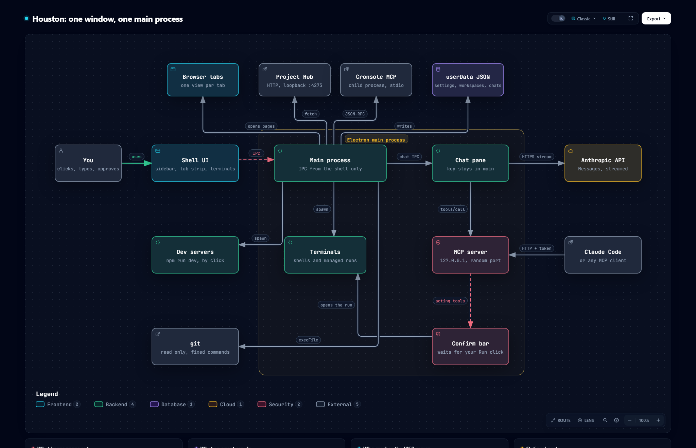

<h1 align="center">🧭 Diagrams</h1>

<p align="center">
  <em>How Houston's one window is put together, drawn from the code and checked against it.</em>
</p>

<p align="center">
  
  
  <a href="../README.md"></a>
</p>

---

## 🏗️ App architecture

[](app-architecture.html)

What sits behind the window: you work in the shell UI, which talks to the Electron main process
over IPC that refuses every sender but the shell. The main process opens the sandboxed browser
tabs, fetches files and bookmarks from Project Hub, starts Cronsole's MCP server as a child
process, keeps its JSON files in userData, spawns the PowerShell terminals and runs the chat panel,
whose API key never leaves it. The MCP server on `127.0.0.1` takes calls from the chat panel and
from Claude Code (or any MCP client) with the per-launch token, and its acting tools wait on the
confirm bar before anything is typed into a terminal or run in Cronsole. Below the map, four cards
cover what keeps pages out, what an agent can do, who reaches the MCP server, and the optional parts.

**See it on the [homepage](https://houston.ai-automation-tools.dev/#architecture)**, or open the interactive version: [`app-architecture.html`](app-architecture.html) in a browser
from a clone, or [render it from GitHub](https://raw.githack.com/ai-automation-tools/houston/main/docs/diagrams/app-architecture.html).
Each component links to the exact lines it describes at the pinned commit, and the viewer adds route
tracing, search, light/dark, and SVG/PNG export.

## 📂 Files

| File | What it is | Edit it? |
|:---|:---|:---|
| [`app-architecture.json`](app-architecture.json) | The source: components, connections, the boundary, cards, and the code each component cites | **Yes, this is the only file you edit** |
| `app-architecture.html` · `.png` | Generated: the interactive diagram, which the homepage embeds live, and a static PNG snapshot | Never; rebuild |
| `houston-site/app-architecture.html` · `.png` | Copies the build writes into the homepage repo, a separate private repo whose root Pages publishes. `--check` flags a copy that differs | Never; rebuild |
| `app-architecture.delivery.json` · `.sources.lock.json` | Build receipt, and the git blob of every cited file at the pinned commit | Never; rebuild |
| [`../../scripts/build-diagram.mjs`](../../scripts/build-diagram.mjs) | Builds the diagram and checks it for drift | Only to change how it builds or checks |

## 🔁 Keeping it current

Every component cites code by path and line range, pinned to the commit in `meta.repository.revision`.
The cited files are `main.js`, `tabs.js`, `hub.js`, `docs.js`, `cronsole.js`, `store.js`,
`chat.js`, `terminal.js` and `mcp.js` in `src/main/`; `chat.js`, `cronsole.js`, `mcp.js`,
`confirm.js`, `tools.js` and `shells.js` in `src/shared/`; `src/preload/shell.cjs`; and
`src/renderer/app.js`. When one changes, the diagram may describe logic that moved or no longer
exists, so it counts as stale until someone has re-read that code.

| When | What catches it |
|:---|:---|
| **Every push and PR** | CI's *Diagram drift* step runs `--hook --no-site` and turns each finding into a warning annotation. It never fails the build |
| **Any time** | `node scripts/build-diagram.mjs --check` exits 1 and names the stale files |
| **Weekly** | The repo owner's doc drift check runs `--check` on the local clone, and the org upkeep job rebuilds a stale diagram by PR |

The homepage lives in its own repo, so the builder needs a clone of it. By default that is
`../houston-site`, next to this one; pass `--site <path>` for another place, or
`--no-site` to skip the copies (CI does, since it has no clone). Without either, a missing clone
is an `ISSUE` in `--check` and a failed build.

To bring it up to date:

1. Commit the code change first. Evidence is pinned to committed bytes, never to working-tree edits.
2. Re-read each changed file the check named. In `app-architecture.json`, fix the line ranges in
   `sources` (at most three per component), and any label, sublabel, connection or card the change
   made untrue. A new process or outside service gets a component in the row of its neighbours;
   a removed one goes. Keep the existing ids.
3. Rebuild, re-pinning to the commit you just read:

   ```powershell
   node scripts/build-diagram.mjs --pin-head
   ```

4. Commit the JSON and the generated files here with a [CHANGELOG](../CHANGELOG.md) line, and the two
   copies in `houston-site` there, by PR on each repo.

Building needs Node 18+, Chrome, and the [Archify](https://github.com/tt-a1i/archify) skill
(default path `~/.claude/skills/archify/bin/archify.mjs`; pass `--archify <path>` to point
elsewhere). The check needs only git. A failed build exits 1 and leaves the last good HTML and
PNG in place; the reason is in `docs/diagrams/.build/app-architecture.finalize-summary.json`.

---

<p align="center">
  <a href="../README.md">← Docs home</a> ·
  <a href="../../README.md">Repository home</a>
</p>
